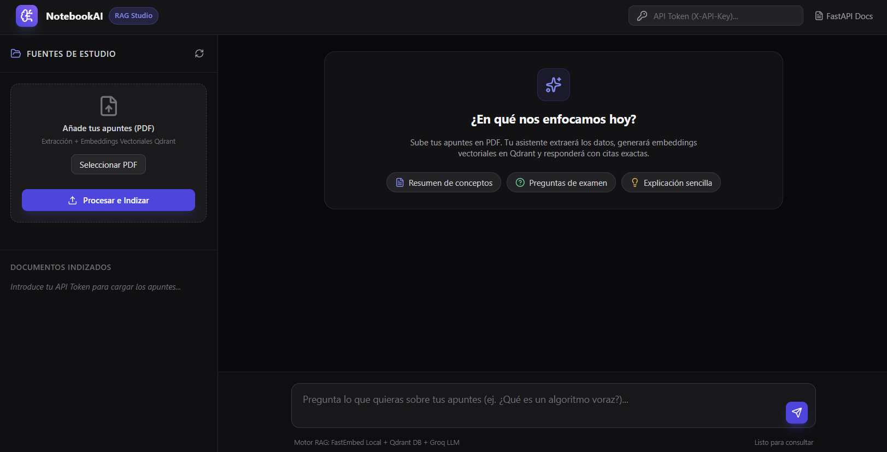
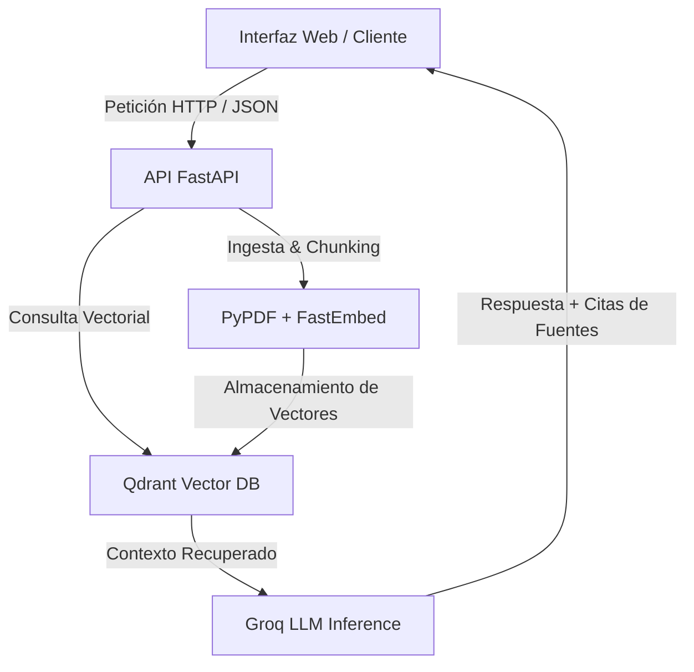

# NotebookAI: Sistema RAG para Análisis e Indización de Documentos

Sistema de recuperación y generación aumentada (RAG, *Retrieval-Augmented Generation*) diseñado para el procesamiento de documentos académicos y técnicos. Permite la ingesta de archivos PDF, la generación de embeddings vectoriales, el almacenamiento persistente mediante una base de datos vectorial y la síntesis de respuestas mediante un Modelo de Lenguaje de Gran Escala (LLM) con atribución explícita de fuentes.

[](https://github.com/Oscar-Munoz-Garcia/asistente-estudio/actions)
[](https://fastapi.tiangolo.com/)
[](https://qdrant.tech/)
[](https://www.docker.com/)

---

## Demostración y Enlaces de Acceso

- **Aplicación Web (Interfaz RAG Studio):** [https://asistente-estudio-3058.onrender.com/](https://asistente-estudio-3058.onrender.com/)
- **Especificación Interactiva API (OpenAPI/Swagger):** [https://asistente-estudio-3058.onrender.com/docs](https://asistente-estudio-3058.onrender.com/docs)  
*(Nota: El tiempo de respuesta inicial en la instancia de prueba puede demorarse ~60 segundos debido al ciclo de inicio en frío del entorno sin servidor).*

---

## Características Técnicas

- **Ingesta y Segmentación de PDFs:** Procesamiento de documentos con `pypdf` y estrategia de particionado dinámico (*chunking* con solapamiento) para preservar el contexto semántico entre fragmentos.
- **Indexación Vectorial Persistente (Qdrant DB):** Vectorización e inserción de fragmentos utilizando `qdrant-client` bajo métrica de similitud por coseno en espacio vectorial de dimensión 384. Soporta ejecución en disco local y sincronización con Qdrant Cloud.
- **Generación de Embeddings Locales:** Uso de la librería `fastembed` para la inferencia de embeddings en entorno local, optimizando la latencia y eliminando la dependencia de APIs externas en la fase de recuperación.
- **Inferencia de LLM:** Integración con la API de Groq (`openai/gpt-oss-20b`) para la síntesis de respuestas contextualizadas con citas trazables hacia los fragmentos fuente.
- **Pipeline de Evaluación (*LLM-as-a-Judge*):** Módulo de evaluación automatizada en Python para la medición objetiva de *Faithfulness* (fidelidad al contexto) y *Relevance* (relevancia de la respuesta).
- **Interfaz de Usuario Basada en Web:** Cliente dinámico integrado en el servidor FastAPI (`/`) con arquitectura de tres paneles, gestión de fuentes, atajos de consulta y visualización de puntuación de similitud por fragmento.
- **Seguridad y CI/CD:** Autenticación en capa de aplicación vía cabecera `X-API-Key`, contenedorización mediante Dockerfile optimizado y validación de integración continua con GitHub Actions.

---

## Arquitectura del Sistema



---

## Evaluación del Sistema RAG (*LLM-as-a-Judge*)

Para auditar la calidad del pipeline RAG de forma objetiva, se implementó un script de evaluación (`evaluacion/evaluar.py`) sobre un conjunto de datos de prueba (`evaluacion/dataset.json`). Un LLM actúa como juez evaluando cada par pregunta-respuesta en una escala discreta de 1 a 5.

| Métrica | Definición | Puntuación Media |
| :--- | :--- | :---: |
| **Fidelidad (*Faithfulness*)** | Grado en que la respuesta se fundamenta estrictamente en el contexto recuperado | **3.67 / 5.0** |
| **Relevancia (*Relevance*)** | Grado en que la respuesta satisface directamente la consulta realizada | **3.67 / 5.0** |

*Comando de ejecución del pipeline de evaluación:*
```bash
python evaluacion/evaluar.py
```

---

## Stack Tecnológico

- **Core & API Framework:** Python 3.11, FastAPI, Pydantic, Uvicorn.
- **Motor RAG & Vector Store:** Qdrant Client, FastEmbed, PyPDF, Groq API.
- **Frontend Layer:** HTML5, Tailwind CSS, Lucide Icons, Fetch API.
- **DevOps, Testing & Cloud:** Docker, GitHub Actions, Pytest, Render.

---

## Configuración y Despliegue Local

### 1. Clonar el repositorio e instalar dependencias
```bash
git clone https://github.com/Oscar-Munoz-Garcia/asistente-estudio.git
cd asistente-estudio
python -m venv .venv

# En Windows:
.venv\Scripts\activate

# En Linux/macOS:
source .venv/bin/activate

pip install -r requirements.txt
```

### 2. Configuración de Variables de Entorno
Crear un archivo `.env` en la raíz del proyecto con la siguiente estructura:
```env
API_TOKEN=tu_token_de_seguridad
GROQ_API_KEY=tu_clave_de_groq
UMBRAL_SIMILITUD=0.3
MODO_BUSQUEDA=significado

# Configuración opcional para Qdrant Cloud:
# QDRANT_URL=https://xxxxxxxx.aws.cloud.qdrant.io:6333
# QDRANT_API_KEY=tu_clave_qdrant
```

### 3. Ejecución del servidor de desarrollo
```bash
uvicorn app.main:app --reload
```
Acceso a la interfaz web local: `http://127.0.0.1:8000/`.

---

## Despliegue con Docker

### Construcción de la imagen e inicio del contenedor
```bash
# Construir imagen Docker
docker build -t asistente-estudio .

# Ejecutar contenedor vinculando volumen para la persistencia de Qdrant
docker run -d --name asistente -p 8001:8000 --env-file .env -v asistente-datos:/app/data asistente-estudio
```
Acceso a la aplicación en contenedor: `http://127.0.0.1:8001/`.